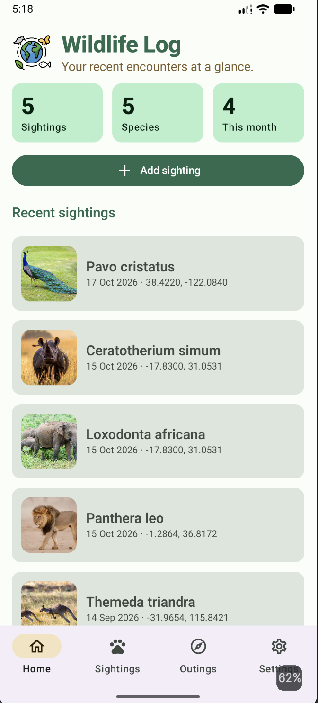
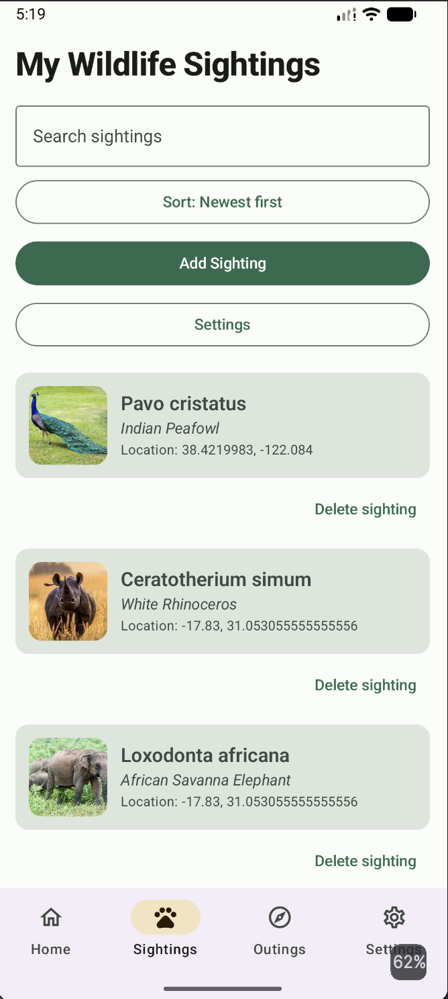
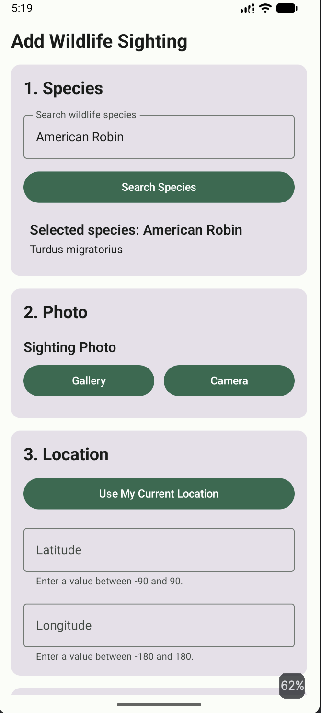
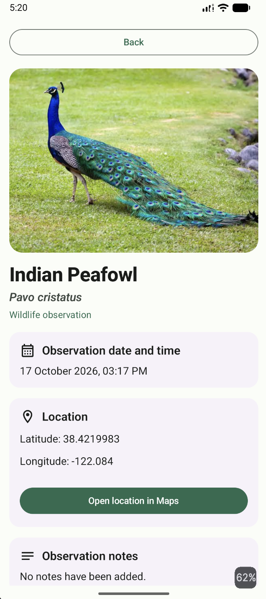
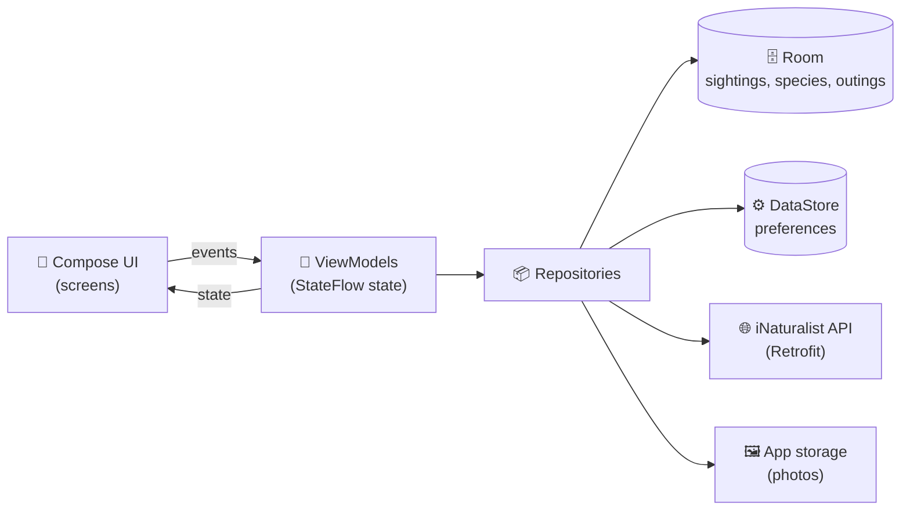

<div align="center">

# 🦉 Wildlife Log

**Log the wildlife you spot, with a photo, a place and the species identified.**


</div>

---

## 📖 About

Wildlife Log is an Android app for **hobby birdwatchers and hikers** who want a simple personal record of what they have seen. Instead of scattered photos and notes, each sighting keeps its species, location, photo and date together, and everything works offline once saved.

Search for a species by name, attach a photo from the camera or gallery, record where you saw it, and open the spot in Maps later.

## ✨ Features

| | Feature | Details |
|---|---|---|
| 🏠 | **Home dashboard** | Total sightings, species seen, sightings this month, and your latest entries |
| 🔍 | **Species search** | Live lookup through the iNaturalist API with loading, empty and error states plus **Retry** |
| 📸 | **Camera and gallery** | Take a photo or pick one; photos are copied into private app storage |
| 📍 | **Location and Maps** | Save coordinates and open the location in a maps app |
| ✏️ | **Add, edit, delete** | Full control over your sightings, stored locally with Room |
| ⚙️ | **Name preference** | Show common or scientific names everywhere, remembered with DataStore |
| 🌗 | **Light and dark theme** | Nature-inspired Material 3 palette |
| 📴 | **Works offline** | Saved sightings stay available without internet |
| ♿ | **Accessibility** | Large text support, content descriptions and adaptive layouts |

## 🖼️ Screenshots


| Home | Sightings | Add sighting | Detail |
|---|---|---|---|
|  |  |  |  |

## 🏗️ Architecture

The app follows **MVVM**. Composables only display state and send events; ViewModels own the state; repositories hide where data comes from.



### 🗂️ Project structure

```
app/src/main/java/com/example/wildlife_app/
├── data/
│   ├── local/        Room entities, DAOs, database, photo storage
│   ├── remote/       Retrofit API, DTOs, mappers
│   ├── datastore/    User preferences
│   └── repository/   Repositories combining the sources above
├── domain/model/     Clean models used by the UI
├── ui/
│   ├── home/         Dashboard
│   ├── sightinglist/ Sightings list
│   ├── addedit/      Add and edit form
│   ├── detail/       Sighting detail
│   ├── settings/     Preferences
│   ├── splash/       Animated launch screen
│   ├── components/   Shared composables
│   └── theme/        Colours, typography, theme
└── navigation/       Destinations, nav graph, bottom bar / rail
```

### 🗄️ Data model

```
Species  1 ───── * Sighting * ───── 0..1 Outing
```

- `Species.id` is the **iNaturalist taxon ID**, so the same species can never be stored twice.
- A species with sightings cannot be deleted, but deleting an outing keeps its sightings.

## 🛠️ Tech stack

| Area | Library |
|---|---|
| Language | Kotlin 2.2.10 |
| UI | Jetpack Compose, Material 3 |
| Navigation | Navigation Compose |
| Local database | Room 2.8.5 (KSP) |
| Preferences | DataStore (Preferences) |
| Networking | Retrofit 3, OkHttp 5, kotlinx.serialization |
| Images | Coil 3 |
| Async | Kotlin Coroutines and Flow |

## 🚀 Getting started

### Requirements

- 🧰 Android Studio (a recent stable release)
- ☕ JDK 17 or newer (the Android Studio bundled JDK works)
- 📱 Android 7.0 (API 24) or newer device or emulator

### Build and run

```bash
git clone https://github.com/RayanMendis56/wildlife-app.git
cd wildlife-app
```

1. Open the folder in Android Studio and let Gradle sync.
2. Pick a device or emulator.
3. Press **Run ▶**.

Or from the terminal:

```bash
./gradlew assembleDebug        # Windows: gradlew.bat assembleDebug
```

> 🔑 **No API key needed.** The iNaturalist read endpoints are public.

### 🎬 Try the main features

| To see... | Do this |
|---|---|
| 🌐 Network states | Add sighting → search `robin`. Turn on airplane mode and search again to see the error and **Retry** |
| 📸 Camera | Add sighting → **Camera**. Deny the permission once to see the fallback message |
| 🖼️ Gallery | Add sighting → **Gallery** |
| 📍 Maps | Open a sighting → **Open location in Maps** |
| ⚙️ Preference | Settings → switch to scientific names, then check Home and Sightings |
| 📴 Offline | Turn on airplane mode: saved sightings still open and edit normally |

## 🔒 Privacy

- No account, login or analytics.
- Sightings and photos stay **on the device**, in the app's private storage.
- The only network call is the species search, which sends the text you type.
- The camera permission is requested only when you tap **Camera**.

## ⚠️ Known limitations

- Photos that are replaced or removed stay in app storage until the app is uninstalled.
- Species data depends on iNaturalist, so some taxa have no common name or photo.

## 🗺️ Roadmap

- [ ] Use current location when logging a sighting
- [ ] Clean up unused photo files
- [ ] Export sightings (CSV or share sheet)
- [ ] Filter sightings by species or date

## 🙏 Acknowledgements

- 🌿 Species data from the [iNaturalist API](https://api.inaturalist.org/v1/docs/), shared under its respective licences.
- 🤖 Generative AI (Claude,Copilot) was used to explain concepts and review code that the authors tested and understand.

## 👥 Contributors

| Contributor | Main areas |
|---|---|
| [Rayan Mendis](https://github.com/RayanMendis56) | App design and data schema, Room database (entities, DAOs, relations), iNaturalist API layer and bad-data handling, camera / gallery / Maps, theme and shared UI components |
| [Sanuda Warampathi](https://github.com/Sanuda124) | Compose screens, polish of existing screens, Outings, home dashboard, navigation shell|
| [Devnitha Dewasinghe](https://github.com/DEWWA06) | ViewModels and UI state, Settings and DataStore preference, network states with Retry, usability and accessibility checks |

